<p align="center">
  
</p>

<p align="center">
  <a href="https://github.com/CarlozPluma">
    
  </a>
</p>

---

## 📜 Relatório do Recruta

```yaml
nome: Carlos Eduardo Pluma Lucena
base: Fortaleza - CE
posto_atual: Técnico de TI @ Simplifique Home Center
especialidade: Desenvolvimento Backend
treinamento:
  - Análise e Desenvolvimento de Sistemas — Uniateneu (2026)
  - Programação Full Stack com IA — Infinity School (2026)
  - Pós em Engenharia de Software com DevOps — Unifor (em andamento)
missão: transformar processos manuais em sistemas automatizados
```

No dia a dia trabalho com **Oracle** e o ERP **Winthor**, suporte às filiais e monitoramento de infraestrutura com **Zabbix**. Fora do expediente, construo APIs e sistemas web para resolver problemas reais.

## ⚔️ Equipamento de Manobra

<p>
  
  
  
  
  
  
  
</p>
<p>
  
  
  
  
  
  
</p>

## 🏰 Missões Além da Muralha

<p>
  <a href="https://github.com/CarlozPluma/AssetFlow">
    
  </a>
</p>

| Missão | Arsenal | Status |
|---|---|---|
| **AssetFlow** — gestão de ativos de TI | Python · Flask | 🟢 Em campo |
| **EstoquePro** — inventário de TI por filial | Backend + banco relacional | 🟡 Em andamento |
| **Financeiro App** — controle financeiro pessoal (PWA) | React · TypeScript · Supabase | 🟡 Em andamento |
| **Sisters Pluma** — e-commerce com checkout via Pix | Node.js · Express · PostgreSQL | 🔒 Privado |

## 📊 Registros de Batalha

<p align="center">
  
  
</p>

<p align="center">
  
</p>

## 📡 Sinalizadores

<p>
  <a href="https://www.linkedin.com/in/SEU-USUARIO/"></a>
  <a href="mailto:SEU-EMAIL@exemplo.com"></a>
</p>

<p align="center"><i>"O que está além da muralha é só mais um problema esperando por uma solução."</i></p>
